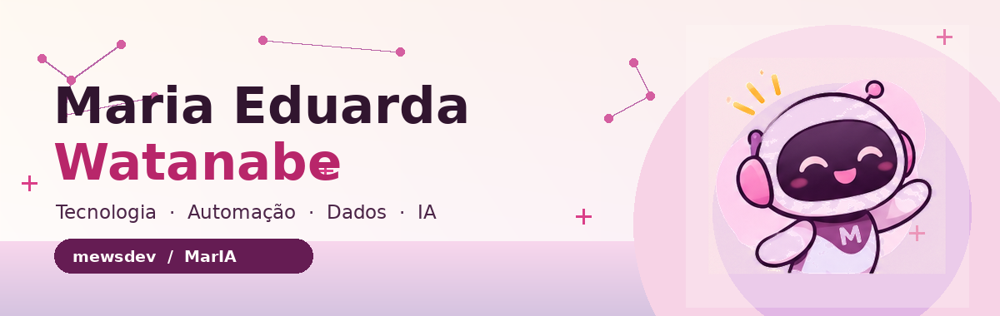
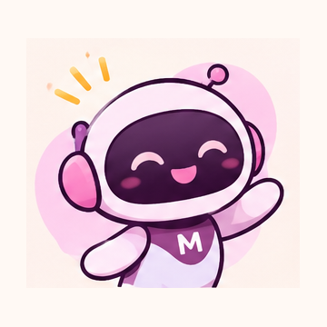
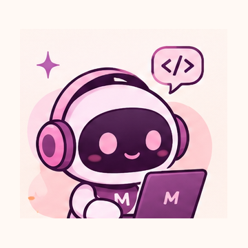
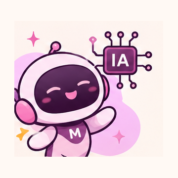
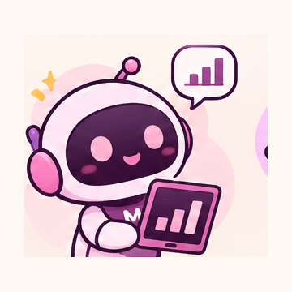
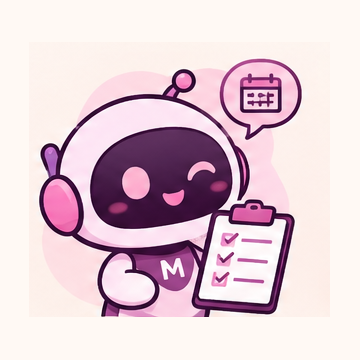
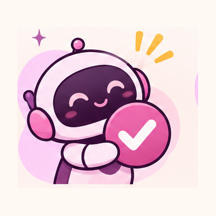

  

  <h3>Oi! Eu sou a Duda 👋</h3>
  
Transformo problemas de negócio em soluções digitais — da descoberta à entrega.

  

    <a href="https://www.linkedin.com/in/mewsdev/">LinkedIn</a> ·
    <a href="https://mwatanabec.github.io/marIA/">Portfólio</a> ·
    <a href="https://www.instagram.com/mewatanabe/">Instagram</a>
  

---

<table>
  <tr>
    <td width="68%" valign="middle">
      <h3>✨ Um pouco sobre mim</h3>
      Trabalho na interseção entre <b>negócio, tecnologia e execução</b>: entendo processos, desenho soluções, desenvolvo automações e conecto dados para facilitar decisões.
        
      Gosto de acompanhar o ciclo completo: <b>discovery → arquitetura → desenvolvimento → implantação → evolução</b>.
        
      Me interesso por produtos internos, inteligência artificial aplicada, integração de sistemas e ferramentas que realmente economizam tempo.
    </td>
    <td width="32%" align="center">
      
    </td>
  </tr>
</table>

## 🚀 O que eu construo

| Área | Onde eu atuo |
|---|---|
| **Automação & IA** | Agentes, assistentes, fluxos e integrações com governança |
| **Dados & Indicadores** | SQL, modelagem, análise, dashboards e observabilidade |
| **Produtos & Sistemas** | Discovery, arquitetura, APIs, aplicações web e implantação |
| **Projetos & Processos** | Requisitos, priorização, alinhamento negócio–técnico e entregas |

## 🛠️ Tecnologias e ferramentas

`Python` · `SQL` · `PostgreSQL` · `Oracle` · `TypeScript` · `React` · `Next.js` · `NestJS` · `Docker` · `Git` · `GitHub` · `Power BI` · `Playwright` · `Claude Code`

## 💜 Projetos e experiências em destaque

<table>
  <tr>
    <td width="50%" valign="top">
      
      <h3>AI Operations Room</h3>
      Observabilidade visual de sessões e agentes de IA, com foco em acompanhamento de execuções.
    </td>
    <td width="50%" valign="top">
      
      <h3>DUDIA</h3>
      Assistente e ambiente de apoio para organização, acompanhamento e visibilidade de projetos.
    </td>
  </tr>
  <tr>
    <td valign="top">
      
      <h3>Dados e conciliação</h3>
      Soluções para conciliação, regras de negócio e leitura de indicadores operacionais.
    </td>
    <td valign="top">
      
      <h3>CRM e plataformas internas</h3>
      Experiência em descoberta, construção e evolução de aplicações corporativas.
    </td>
  </tr>
</table>

> Alguns cases são experiências profissionais e não possuem código público. Aqui compartilho somente descrições e materiais que posso divulgar.

## 📊 GitHub

---

  
  
<b>Ideias saem do papel quando tecnologia e negócio caminham juntos.</b>

  Feito com 💗 e identidade MarIA · @mewatanabe

